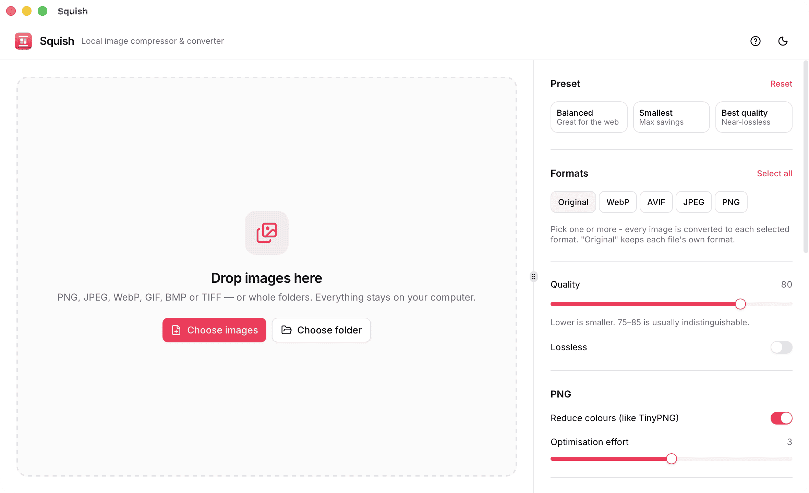

# Squish

[](https://github.com/BayBreezy/squish/actions/workflows/ci.yml)
[](https://github.com/BayBreezy/squish/releases)
[](LICENSE)

**A local, offline alternative to TinyPNG / Tinify.** Drop in images (or whole folders), pick one or more output formats and a quality, and Squish compresses and converts them on your own machine. Nothing is uploaded anywhere.

<p align="center">
  <picture>
    <source media="(prefers-color-scheme: dark)" srcset="docs/screenshots/app-empty.png" />
    
  </picture>
</p>

<!-- Add a screenshot of the app with processed images: save it as docs/screenshots/app-results.png, then uncomment:
<p align="center"></p>
-->

Built with **Nuxt 4** (SPA) + **UI Thing** + **Tauri 2**. All pixel work happens in Rust.

## Features

- **Drag & drop** files or whole folders, or use the native file picker
- **Several formats at once:** tick any of PNG, JPEG, WebP and AVIF (or "Original" to keep each file's own format) and every image is converted to each one. Each image is decoded and resized once, then encoded per format
- **Smart compression per codec**
  - PNG: palette quantisation with [imagequant](https://github.com/ImageOptim/libimagequant) (the engine behind pngquant), then lossless [oxipng](https://github.com/shssoichiro/oxipng)
  - JPEG: [mozjpeg](https://github.com/mozilla/mozjpeg) (progressive, trellis)
  - WebP: libwebp, lossy or lossless
  - AVIF: [ravif](https://github.com/kornelski/cavif-rs) / rav1e
- **Quality controls:** a quality slider, presets (Balanced / Smallest / Best quality), lossless mode, and per-format options
- **Resize** to fit a maximum width and/or height (never upscales)
- **iPhone-ready:** reads **HEIC/HEIF** photos (including Display P3 colour), converts wide-gamut images to sRGB, and bakes in orientation
- **Privacy by default:** photo metadata (EXIF, GPS location) is stripped unless you turn on _Keep metadata_
- **Safe by design**
  - Originals are never modified or overwritten (name clashes become `name-squished (2).webp`)
  - A converted file that would be larger than the original is skipped (switchable)
  - Re-compressing a file in its own format never makes it bigger
  - EXIF orientation is applied, so phone photos stay upright
  - One corrupt file never aborts a batch
- **Fast and responsive:** parallel processing with live per-format results, cancel at any time
- **Before / after viewer:** drag a divider across the original and the result to judge quality before you keep a file
- **Desktop niceties:** native menu (File → Add Images `⌘O`, Add Folder `⇧⌘O`, Start `⌘↩`), a built-in How-to guide (`⌘/`) and shortcuts list (`⌘K`), resizable settings panel, light/dark theme, remembers window size and position

## Using Squish

1. **Add images.** Drop files or folders onto the window, or use _Choose images_ / _Choose folder_.
2. **Pick settings.** Start with a preset, tick the formats you want, adjust quality, and optionally set a maximum width or height.
3. **Press Squish.** Progress streams in per file and per format.
4. **Find your files.** Results are written next to each original with a `-squished` suffix (or into a folder you choose under _Output → Save to_). Each row shows the size and saving per format, with the smallest highlighted.

Folders are scanned recursively. Only image files are processed; other files are ignored and the app tells you how many.

### Supported formats

|                | Input                        | Output                                       |
| -------------- | ---------------------------- | -------------------------------------------- |
| PNG            | ✅                           | ✅                                           |
| JPEG           | ✅                           | ✅                                           |
| WebP           | ✅                           | ✅                                           |
| AVIF           | ❌                           | ✅                                           |
| HEIC / HEIF    | ✅                           | ❌ ("Original" becomes JPEG)                 |
| GIF, BMP, TIFF | ✅ (first frame / flattened) | ➜ written as PNG when "Original" is selected |

## Install

Download the installer for your system from the **[Releases page](https://github.com/BayBreezy/squish/releases)**:

| OS      | File                                              |
| ------- | ------------------------------------------------- |
| macOS   | `.dmg` (`aarch64` = Apple Silicon, `x64` = Intel) |
| Windows | `.exe` installer or `.msi`                        |
| Linux   | `.AppImage`, `.deb` or `.rpm`                     |

Builds are not code-signed yet, so the first launch may show a security warning:

- **macOS:** open the app once and dismiss the warning, then go to _System Settings → Privacy & Security_, scroll down and click **Open Anyway**. (On macOS 15 and later, right-click → Open no longer bypasses this.) Alternatively, clear the quarantine flag once in Terminal:
  ```bash
  xattr -dr com.apple.quarantine /Applications/Squish.app
  ```
- **Windows:** _More info_ → _Run anyway_.

Or build it yourself (below). How releases are produced is described in [docs/RELEASING.md](docs/RELEASING.md).

## Develop

Requirements: [Bun](https://bun.sh), [Rust](https://rustup.rs) 1.90+, and the Tauri [system prerequisites](https://v2.tauri.app/start/prerequisites/) (Xcode Command Line Tools on macOS).

```bash
bun install
bun run tauri dev      # desktop app with hot reload
bun run tauri build    # release bundle (.app / .dmg on macOS)
```

The first Rust build takes a few minutes (it compiles the image codecs); later builds are incremental.

Checks:

```bash
cd src-tauri && cargo test && cargo clippy --all-targets -- -D warnings
bun run lint            # oxlint
bun run format:check    # oxfmt (use `bun run format` to write)
bunx nuxt typecheck
```

## Project layout

```
app/                       Nuxt frontend
  pages/index.vue          the whole UI: drop area, file list, splitter, settings
  components/              DropZone, FileRow, SettingsPanel, CompareDialog, HowToSheet, IconButton, AppLogo
  components/Ui/           UI Thing components
  composables/             useImageQueue, useSettings, useTauriDrop, useHelp, useMenuActions
  types/squish.ts          types mirroring the Rust side
src-tauri/
  src/lib.rs               Tauri builder: plugins, state, command registration
  src/commands.rs          IPC commands called from the frontend
  src/menu.rs              native menu, About panel, Help item
  src/pipeline/            decode → orient → resize → encode (one file per codec) + tests
  icons/source/            app icon source (SVG); regenerate with `bunx tauri icon`
.github/workflows/         CI (ci.yml) and release builds (release.yml)
scripts/                   check-version.mjs: keeps the three version numbers in sync
docs/
  rust-primer.md           short Rust/Tauri guide for this codebase
  RELEASING.md             how to publish a new version
  screenshots/             README images
```

### How it fits together

The webview never touches image bytes. It sends file **paths and settings** to Rust over Tauri IPC, and receives small JSON events back through a channel (`started`, `output`, `skipped`, `done`, …). Thumbnails are produced by Rust and sent as bytes, so no filesystem scope is exposed to the webview. See [docs/rust-primer.md](docs/rust-primer.md) if you are new to Rust.

## Colour, metadata and HEIC

- **Colour:** images with an embedded ICC profile (Display P3 from iPhones, Adobe RGB, ProPhoto, …) are converted to sRGB while decoding, so outputs look the same everywhere. Outputs are written untagged (sRGB).
- **Metadata:** removed by default (smaller files, no location leaks). _Output → Keep metadata_ copies EXIF into JPEG, PNG and WebP outputs, with the orientation tag reset because the pixels are already rotated. AVIF outputs never carry metadata.
- **HEIC:** decoded with a pure-Rust HEVC still-image decoder ([heic-rs](https://github.com/tbraun96/heic-rs)), so no libheif or C toolchain is needed. On macOS, files it can't read are handed to the system decoder (`sips`) automatically.
- **Animated GIF / WebP / APNG:** only the first frame is processed. The file row and a notification say so when you add one.

## Known limitations

- **HEIC outside macOS:** the pure-Rust decoder is young and rejects some HEVC variants (for example Apple's 3840×2160 wallpaper HEIC). Typical iPhone photos are the common case, but on Windows and Linux a file it can't read is reported as unsupported.
- **No AVIF input**, and HEIC can't be an output format ("Original" on a HEIC writes JPEG).
- **One quality value is shared by all formats**, and "80" is not perceptually identical between JPEG, WebP and AVIF.
- **Metadata is EXIF only.** XMP, IPTC and ICC profiles are not carried over.
- Developed and tested on **macOS (Apple Silicon)**. Windows and Linux are expected to work but are untested.

## Notes

- Unsigned builds trigger macOS Gatekeeper warnings on other machines; public distribution needs an Apple Developer ID and notarisation.

## License

GPL-3.0-or-later (see [LICENSE](LICENSE)). The PNG quantiser, imagequant, is GPL-3.0, so the combined work is too.
